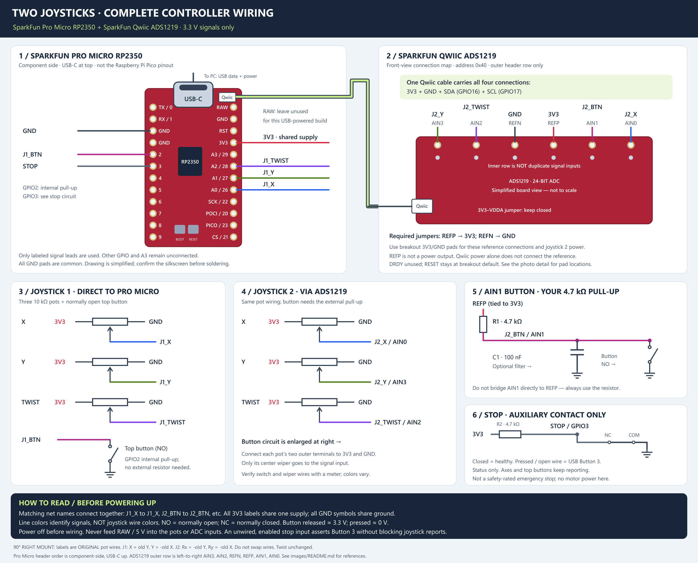
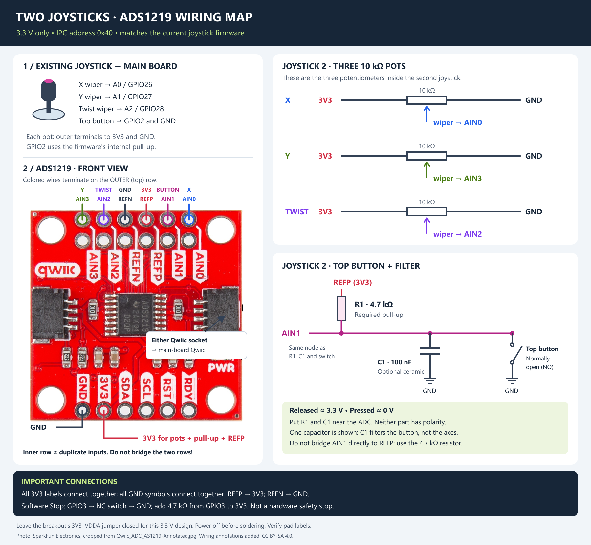

# Joystick Control Panel

[design/joystick.scad](design/joystick.scad) uses a SaiDian 4-axis mini
joystick as its reference control and generates the surrounding panel.

## Customization

- Set `joystickCount` to select the number of joysticks.
- Enable `e_stop` to add the button opening and set `e_stop_diameter` to fit.
- Adjust `verticalUnits` and inspect the calculated panel width and clearances.

Measure the actual joystick and button before fabrication. The optional
emergency-stop feature is a mechanical opening only; it does not implement
or certify a safety circuit.

## USB firmware and pin assignments

[Open the complete controller wiring diagram](images/controller-wiring.png)
([zoomable SVG](images/controller-wiring.svg)).

The composite shows the **SparkFun Pro Micro RP2350**, component-side with
USB-C at the top, not a generic Raspberry Pi Pico. Matching signal labels
connect the board maps to the joystick circuits; all 3V3 and GND labels are
shared nets. The Qwiic cable carries power, ground, SDA and SCL. Board
drawings are simplified: verify silkscreen labels before soldering.

[Open the ADS1219 photo wiring detail](images/ads1219-wiring.png)
([editable SVG](images/ads1219-wiring.svg)).

The image uses a full-board photo of the SparkFun ADS1219 so its 3V3 and
GND pads are visible. The two header rows are **not duplicate inputs**:
use the outer row for AIN0..AIN3 and REFP/REFN. See
[image attribution](images/README.md).

`joystick/joystick.cpp` targets the **SparkFun Pro Micro RP2350** and
supports two of the reference joysticks (three 10k potentiometers and one
normally open top button each). The advertised fourth "axis" is a button,
not a fourth potentiometer. Verify your particular joystick with a meter:
wire colors and connector pin numbers vary, so the assignments below use
electrical functions, not assumed wire colors.

Power both joysticks from **3V3, never RAW/5V**. Each pot's outer terminals
go to 3V3 and GND; its wiper goes to the assigned input. Share ground between
both boards, all pots, and all switches. Identify the wiper by its changing
resistance to either outer terminal; the resistance between outer terminals
stays approximately 10k. Identify the switch pair by continuity on press.

The X/Y wiper names below and in the diagrams refer to the **original,
unrotated potentiometers**. Keep their wiring unchanged when rotating the
joysticks; the firmware remaps their USB axes for the new mounting.

| Control | Connection | USB HID mapping after rotation |
| --- | --- | --- |
| Joystick 1 X wiper | A0 / GPIO26 / ADC0 | Y (negated old X) |
| Joystick 1 Y wiper | A1 / GPIO27 / ADC1 | X (old Y) |
| Joystick 1 twist wiper | A2 / GPIO28 / ADC2 | Z |
| Joystick 1 top button | GPIO2 to GND, normally open | Button 1 |
| Joystick 2 X wiper | ADS1219 AIN0 | Ry (negated old X) |
| Joystick 2 Y wiper | ADS1219 AIN3 | Rx (negated old Y) |
| Joystick 2 twist wiper | ADS1219 AIN2 | Rz (Z Rotation) |
| Joystick 2 top button | ADS1219 AIN1, circuit below | Button 2 |
| Stop auxiliary contact | GPIO3 to GND, normally closed | Button 3 |
| ADS1219 unavailable | Firmware-generated status, no pin | Button 4 |

Compared with the previous wiring, swap joystick 2's Y wiper and button
connections: Y moves from AIN1 to AIN3, and the button from AIN3 to AIN1.
Move the button's pull-up and optional filter capacitor to AIN1 as well.

These are six axes on **one USB gamepad**, not two USB devices. The USB
descriptor remains unchanged. The original Y pot is inverted on both
joysticks by default, before the mounting rotation below. Joystick 2 has
independent
`ADS1219_{X,Y,YAW}_{MIN_RAW,CENTER_RAW,MAX_RAW,INVERT,DEADZONE}` settings.
Its signed 24-bit ADC samples are clamped at zero and scaled to 0..4095
before the existing calibration, inversion, deadzone, and smoothing stages.
Tune calibration to the actual travel and resting positions of each pot.

### Both joysticks mounted 90 degrees to the right

Joystick 1 uses **new X = old Y, new Y = -old X**. Joystick 2 adds an
ADS-only horizontal polarity correction: **Rx = -old Y, Ry = -old X**.
This reverses only the ADS stick's reported horizontal axis relative to the
initial rotation firmware; its vertical axis and twist polarity are unchanged.
Directions refer to the original calibrated USB axes before rotation, with
up/left negative and down/right positive:

| Previous direction | Joystick 1 | Joystick 2 (ADS) |
| --- | --- | --- |
| Up | Left | Right |
| Down | Right | Left |
| Right | Up | Up |
| Left | Down | Down |

Rotation is applied after calibration, inversion, deadzone and smoothing.
Keep the calibration settings and diagram wire labels associated with their
original pots; **do not also swap wires or add another inversion**.
Rotation does not change twist polarity, top buttons, stop behavior, or
missing-ADS1219 handling. Twist HID assignments are described below.
The main USB Y axis now comes from **A0 / GPIO26**, and main USB X from
**A1 / GPIO27**. Joystick 2 Ry comes from AIN0, and Rx from AIN3.

### Twist assignments and checking the ADS range

Joystick 1 (RP) twist is **HID Z from GPIO28 / ADC2**. Joystick 2 (ADS)
twist is **HID Rz (Z Rotation) from AIN2**. These two USB assignments are
swapped from earlier firmware; neither twist direction is inverted.
The diagram's twist labels describe unchanged physical wiring, not HID
axis names. Calibration remains attached to its original pot:
`AXIS_YAW_*` for RP, `ADS1219_YAW_*` for ADS. If ADS is unavailable,
only Rx/Ry/Rz become neutral; RP X/Y/Z remain live.

This reporting swap does not fix an off-center or restricted ADS reading.
All six HID axes are signed, with a declared range of -127..127. A tester
may display a rescaled unsigned range instead, so compare against its
midpoint rather than assuming the displayed number must be negative.

The default `ADS1219_YAW_*` calibration maps normalized raw 0 to -127,
2048 to 0, and 4095 to +127 before smoothing. Clamping negative ADC noise
to raw zero does **not** clamp USB Rz to zero; raw zero maps to negative Rz.
Smoothing and limited mechanical pot travel can reduce the observed range.

If ADS Rz is off-center or only moves on one side, record its released
center and both twist endpoints, along with the tester name. Check AIN2
wiper voltage relative to GND at those same positions; with the default
calibration, center corresponds to about half of REFP (1.65 V for 3.3 V).
Verify the pot's outer terminals are 3V3/GND and its wiper is AIN2 before
adjusting `ADS1219_YAW_MIN_RAW`, `ADS1219_YAW_CENTER_RAW`, and
`ADS1219_YAW_MAX_RAW` to measured travel. Do not infer the center from a
single unknown stick position or hide a wiring fault with calibration.

### ADS1219 Qwiic connection and reference

Use the **7-bit I2C address `0x40`**, not the shifted wire address `0x80`.
The firmware uses I2C0 at 400 kHz. Connect through the onboard Qwiic socket:

| Qwiic signal | Pro Micro RP2350 | ADS1219 breakout |
| --- | --- | --- |
| SDA | GPIO16 | SDA |
| SCL | GPIO17 | SCL |
| Supply | 3V3 | 3.3 V-compatible supply input |
| Ground | GND | GND / AGND / DGND |

**Correction to the old firmware:** GPIO8/9 are not this board's onboard
Qwiic pins. GPIO16=SDA and GPIO17=SCL agree with the schematic and Pico SDK
board definition; SparkFun's hardware-overview prose reverses these labels.
If you already wired a separate connector to GPIO8/9, set `I2C_SDA=8` and
`I2C_SCL=9` instead. The onboard Qwiic bus has pull-ups; check combined bus
pull-ups and cable length if adding more devices. All bus pull-ups must go
to 3.3 V, not 5 V.

**Required analog reference wiring:** the firmware selects gain 1 and the
external reference. Connect **REFP to the same 3V3 rail feeding the pots**
and **REFN to AGND/GND**. AVDD and DVDD must also be correctly powered;
for this design both are 3.3 V. This is a ratiometric measurement spanning
the full pot travel. The internal 2.048 V reference would clip a 3.3 V pot
above 2.048 V; calibration cannot recover that missing travel.

Check your breakout's schematic/jumpers before connecting REFP: do not
short an onboard reference output to 3V3. If REFP/REFN are not exposed or
selectable, this wiring needs a compatible breakout or a redesigned input
scaling/reference arrangement. A Qwiic connector alone does not guarantee
the reference is connected correctly. Keep RESET high as specified by the
breakout (never floating); leave DRDY unconnected because firmware polls
the status register. Keep address selection at `0x40`. On a bare IC,
address-select pins A0 and A1 go to DGND; these are **not** AIN0/AIN1.
Follow the datasheet's supply/reference decoupling requirements.

### Reliably reading the second joystick's button through AIN1

The ADS1219 has no digital GPIO mode or internal button pull-up. Use this
external network, mounted near the ADC:

- **4.7 kohm** resistor from **REFP (tied to 3V3) to AIN1**.
- Normally open joystick switch between **AIN1 and GND**.
- Optional **100 nF** capacitor from **AIN1 to GND** for noise filtering.

The adjacent REFP pad provides a convenient connection to the 3V3 net
for the resistor. **Do not directly bridge AIN1 to REFP**: pressing the
button would short the reference and 3V3 supply to ground. REFP must remain
connected directly to 3V3; the resistor goes only in the branch to AIN1.

Released is approximately 3.3 V (raw 4095); pressed is approximately 0 V
(raw 0), drawing about 0.7 mA through the resistor. Never connect the
switch directly between 3V3 and GND, and never leave AIN1 floating.
The pull-up is needed even when the optional capacitor is fitted.

Firmware asserts the raw button state at or below 1024 (about 0.825 V),
releases it at or above 3072 (about 2.475 V), and retains the previous state
between those thresholds. It then requires 25 ms of consistent sampled
state. This hysteresis plus debounce avoids chatter; adjust
`ADS1219_BUTTON_*_RAW` or `BUTTON_DEBOUNCE_MS` if needed. The four channels
are multiplexed, not simultaneous: 1000 SPS is the converter's total rate,
not 1000 samples/second per control. Firmware cycles single-shot conversions
without blocking on conversion completion; polling and I2C overhead reduce
the effective per-channel rate. Very short button taps may be missed.

### Emergency-stop input and pin budget

**There are enough pins.** ADS1219 AIN0..AIN3 are all occupied, but GPIO3
on the Pro Micro remains available for the stop contact. Main-board
A3/GPIO29 is also unused by this firmware. No GPIO expander or resistor
ladder is needed. An illuminated stop button's lamp would require separate
power/driver consideration; do not power a lamp from GPIO3.

For a low-voltage **auxiliary/status contact** on a latching stop button:

- Connect contact **COM to GND**, and **NC to GPIO3** (not NO).
- Add an external **4.7 kohm pull-up from GPIO3 to 3V3** near the MCU.
  Firmware also enables the internal pull-up.
- Released/healthy: NC closed, GPIO3 low, Button 3 off.
- Pressed, unplugged, or broken wire: NC open, GPIO3 high, Button 3 on.

`ESTOP_ENABLED` defaults to `1`, with `ESTOP_PIN=3`. Set
`ESTOP_ENABLED=0` and rebuild for a panel intentionally lacking a stop
switch; leaving an enabled input unconnected deliberately reports stop.
At boot, firmware asserts Button 3 until the contact is stably closed for
25 ms. An open contact asserts Button 3 on the next loop observation
without press debounce; reclosure must remain stable for 25 ms.
The contact is **status-only**: all six axes and Buttons 1/2 keep reporting
normally while Button 3 is asserted, including at boot or with an open
wire. It does not freeze, center, or suppress joystick input. The ADS fault
status in Button 4 remains independent. USB reports are scheduled every
10 ms, not in real time.

**This is not a safety-rated emergency-stop system.** A USB HID status
button cannot guarantee removal of hazardous energy. Use
an appropriately designed independent safety circuit/safety relay to stop
the machinery; this input may only monitor an isolated auxiliary contact.
Never connect mains, motor power, or an industrial 24 V loop to these pins.
A short to ground can mask a stop, and MCU/USB/host failures can prevent
delivery. Firmware does not inhibit controls, latch, or implement a
manual-reset/rearm interlock. The safety system
and controlling application must prevent automatic restart and require
deliberate rearming. Have a qualified person validate any hazardous system.

### Failure behavior and bench checks

I2C transactions have 2 ms timeouts and conversions have a 20 ms deadline.
On an ADC communication failure/timeout, joystick 2 becomes neutral, its
button releases, Button 4 asserts, and firmware retries after one second.
A complete fresh four-channel scan is required before clearing that fault.
Joystick 1, USB servicing, and the independent GPIO stop continue running.
Set `ADS1219_ENABLED=0` for a deliberate single-joystick build; this also
disables the expansion-fault indication. Incorrect references, disconnected
pot wipers, and an ADC that returns plausible but wrong data are not
diagnosed by the communication-fault flag.

Build with the existing Pico SDK CMake/Ninja project in `joystick/`.
Run `node --test examples/joystick/firmware.test.cjs` from the repository
root for source-contract checks. To also compile and run the firmware's
host-mocked behavioral tests, set `CXX` to an absolute native `clang++` or
`g++` executable path (a Windows `.exe` on Windows). Those tests cover
enabled/disabled builds, ADC commands, signed sample decoding, button
hysteresis/debounce, stop behavior, fault handling, and HID mapping.
Without `CXX`, the behavioral test is explicitly skipped; passing source
checks alone does not establish that the firmware compiles or runs.
Host mocks also cannot validate physical I2C timing or electrical behavior.

Before using the controller with any equipment, test with hazards disabled:

1. Verify 3.3 V supplies, common ground, reference wiring, and I2C address.
2. In a USB gamepad tester, check all six axes independently through full
  travel and verify both top buttons register once per press/release.
3. Press the stop, boot with it pressed, and disconnect its NC wire:
  each should report Button 3 while axes and top buttons remain responsive.
  Verify Button 3 clears after stable contact reclosure and Button 4 still
  reflects ADS availability independently.
4. With power off, disconnect the ADC; reboot and confirm Button 4 while
  joystick 1 and the stop input remain responsive. Reconnect with power
  off and verify recovery. Do not assume the breakout is hot-plug safe.
5. Validate the independent safety circuit and deliberate-rearm behavior
  separately; the USB gamepad tests do not certify them.

References:
[TI ADS1219 datasheet](https://www.ti.com/lit/ds/symlink/ads1219.pdf),
[SparkFun ADS1219 library](https://github.com/sparkfun/SparkFun_ADS1219_Arduino_Library),
[Pro Micro schematic](https://github.com/sparkfun/SparkFun_Pro_Micro_RP2350/blob/main/Hardware/SparkFun_ProMicro_RP2350.sch),
[Pico SDK board definition](https://github.com/raspberrypi/pico-sdk/blob/master/src/boards/include/boards/sparkfun_promicro_rp2350.h).